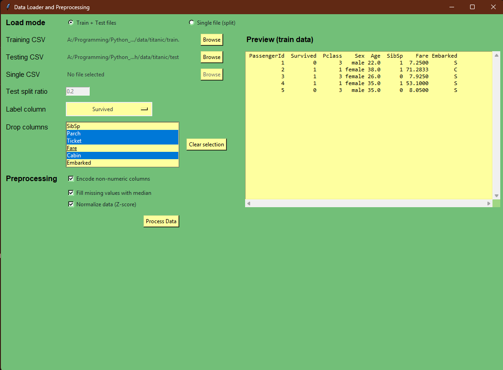
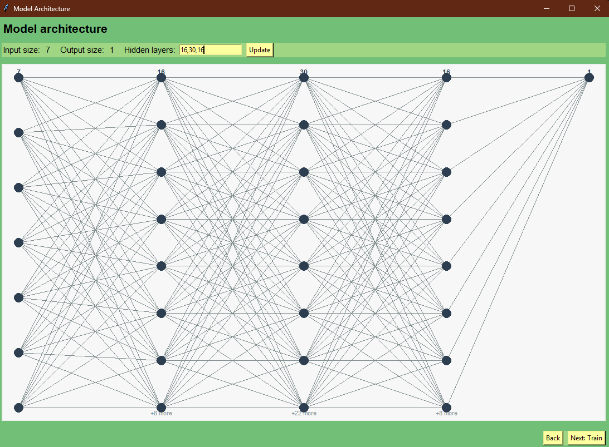
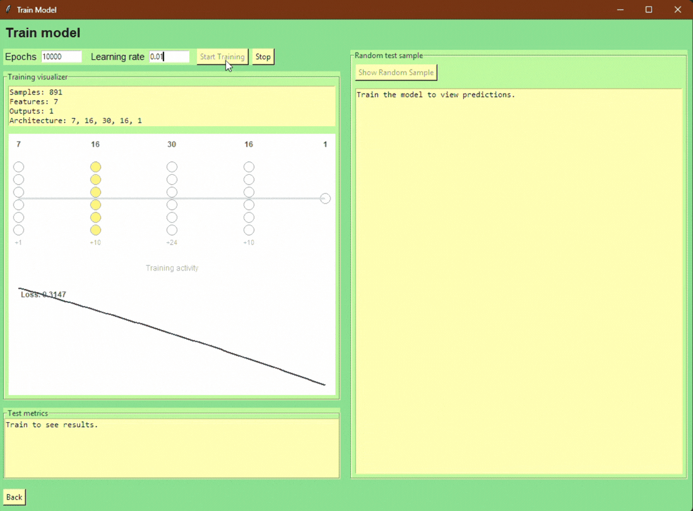

## Neural Network From Scratch with GUI

Build, inspect, and train a tiny fully-connected neural network (Numpy only) with a Tkinter GUI for quick data prep and visualization.

### Demo
- Data prep UI: 
- Graph visualiser: 
- Training animation: 

### Highlights
- GUI for CSV ingest, preprocessing (encode/fill/normalize), architecture preview, and live training animation.
- From scratch Numpy implementation of feedforward/backprop with customizable layer dimensions.
- Titanic demo notebooks for experimentation.

### Quickstart
1) Install deps (Python 3.10+):
  - `python -m pip install -r requirements.txt`
  - For editable dev (src layout): `python -m pip install -e .[dev]`
2) Launch the GUI: `python app.py`
  - Load train/test CSVs (or a single file with split), pick label, tweak preprocessing, then train.
  - Sample data lives in [data/titanic](data/titanic) (Kaggle Titanic CSVs).
3) Run smoke tests: `python -m pytest tests/test_smoke.py`

### Project Structure
```
.
├─ app.py                 # GUI entrypoint
├─ src/
│  └─ nn_from_scratch/    # Library code
│     ├─ data_prep.py     # CSV load/encode/fill/normalize helpers
│     ├─ network.py       # Init/feedforward/backprop/predict
│     └─ ui_style.py      # Shared palette/TTK styling
├─ tests/
│  └─ test_smoke.py       # Sanity checks for prep + training
├─ notebooks/             # NN.ipynb, NN_old.ipynb, NN copy.ipynb, Titanic_demo.ipynb
├─ data/
│  └─ titanic/            # Kaggle Titanic CSVs and notes PDF
├─ docs/                  # Feature specs and repo overview
├─ requirements.txt
└─ pyproject.toml
```

### Using the Library (no GUI)
```python
import numpy as np
from nn_from_scratch.data_prep import encode_non_numeric, fill_missing_values, normalize_data_z_score, split_reshape_data
from nn_from_scratch.network import train_network, predict

# X: features as (features, samples), Y: labels as (outputs, samples)
weights, biases, loss_history = train_network(X, Y, layer_dims=[X.shape[0], 8, Y.shape[0]], epochs=500, learning_rate=0.05)
preds = predict(X, weights, biases)
```

### Notes / To-Do
- Consider packaging for pip (`pyproject.toml`) if you want to distribute the library.
- Add more datasets or preprocessing recipes as needed.
